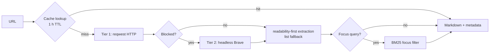

<div align="center">

# scour

Fast, local, Rust-only web scraper: single pages, batch fetches, site crawls, and keyless search — as a CLI or a stdio MCP server.

[](https://github.com/AdamUnderwood375/scour/actions/workflows/ci.yml) [](LICENSE) [](https://github.com/AdamUnderwood375/scour) [](https://github.com/AdamUnderwood375/scour) [](https://github.com/AdamUnderwood375/scour)

</div>

## What it is

`scour` is one small Rust binary (~2,230 lines across `src/main.rs`, `src/fetcher.rs`, `src/cache.rs`, `src/extractor.rs`, edition 2024, MIT) that turns messy web pages into clean markdown for humans and agents. It fetches with plain HTTP when that works, escalates to a headless browser only when blocked, extracts the readable content, and optionally filters long documents down to the paragraphs that match your query.



## Two ways to run it

One binary, two modes, selected by arguments:

- **CLI** — `scour <url> [focus]` prints the page title on line 1, clean markdown on stdout, and metadata (`page_type`, `quality`, links count, `next_offset`) on stderr. Starts in ~7 ms and exits when done; output pipes straight into `head` and `grep`.
- **MCP server** — `scour` with no arguments runs a stdio MCP server exposing 7 tools (`scrape`, `scrape_batch`, `crawl`, `search`, `screenshot`, `cache_clear`, `scour_version`) for agents that want structured JSON.

Use the CLI when you want text on stdout; use MCP when you want typed tool calls. The fetch pipeline underneath is identical.

## Why not just an MCP server

Every MCP server you register injects its tool schemas into the model's context on every turn — roughly 2–3k tokens per session of tool-schema tax, plus a background daemon to manage.

`scour` ships `skills/scour/SKILL.md` so a coding agent can skip MCP registration entirely and run the binary through its normal bash tool instead:

- **No schema tax** — saves roughly 2–3k context tokens per session.
- **Unix output** — markdown on stdout pipes into `head`, `grep`, or files.
- **No daemon** — executes on demand, prints, exits.

Install it by copying `skills/scour/SKILL.md` into the agent's skills directory (see `skills/scour/SKILL.md` for the exact path). MCP stays available for callers that prefer structured JSON.

## Features

- **Single-page scraping** — clean markdown plus title, description, headings, links, and images.
- **Batch scraping** — up to 10 URLs in parallel via `scrape_batch`.
- **Site crawling** — same-domain, best-first focus-aware BFS returning markdown per page plus the link graph.
- **Keyless web search** — DuckDuckGo HTML + Bing in parallel, deduped and ranked; supports `site:`, freshness, and `exclude_sites` filters.
- **Readability-first extraction** — articles via readability, list/index pages (HN, Reddit, search results) via a trafilatura-style fallback.
- **BM25 focus** — a query keeps only the relevant paragraphs of a long document.
- **Two-tier fetching** — ~300 ms plain HTTP first, ~3.5 s headless browser only when blocked.
- **1-hour cache** — in-memory LRU plus a persistent file cache.
- **Screenshots** — full-page base64 PNG via headless Brave.
- **Pagination** — `offset` / `next_offset` for walking long pages.

## Quick start

Requirements: Rust 1.85+ (edition 2024). A browser (Brave or Chromium) is optional — only the fallback tier needs one.

```sh
cargo build --release
./target/release/scour "https://example.com"
```

```sh
cargo test
```

```sh
cargo install --path .
```

After `cargo install --path .`, the binary is on `PATH` as `scour`.
The release build output lands at `./target/release/scour`.

## CLI usage

The CLI takes a URL and an optional focus query — no flags:

```sh
./target/release/scour "https://example.com"
```

```sh
./target/release/scour "https://example.com" "second argument is a BM25 focus query"
```

```sh
./target/release/scour "https://news.ycombinator.com" 2>&1 | head -n 100
```

```sh
./target/release/scour "https://example.com" 2>&1 | grep -i "example"
```

Stdout contract: line 1 is the page title, the rest is clean markdown. Stderr carries the metadata: `page_type`, `quality`, links count, and `next_offset`. With no arguments the binary runs as a stdio MCP server instead of scraping:

```sh
./target/release/scour
```

Once installed to `PATH`, the same invocations work through the installed name:

```sh
scour "https://example.com"
```

```sh
scour "https://example.com" "focus query"
```

Long pages are walked with `offset` (MCP `scrape` param): when stderr reports a `next_offset`, pass it back as `offset` to fetch the next chunk. When a page is long and you only need one section, prefer a focus query over paging through the whole document — the BM25 filter (below) keeps the relevant paragraphs and drops the rest.

## MCP configuration

Add `scour` to your MCP config with the binary path (use `cargo install --path .` and plain `scour` if it is on `PATH`):

```json
{
  "mcpServers": {
    "scour": {
      "command": "/path/to/scour/target/release/scour",
      "args": [],
      "env": { "SCOUR_BROWSER": "/usr/bin/brave" }
    }
  }
}
```

| Tool | What it does | Key params |
|---|---|---|
| `scrape` | Scrapes a single page to markdown + metadata | `url`, `focus?`, `max_chars?`, `include_links?`, `offset?`, `options?` |
| `scrape_batch` | Scrapes up to 10 URLs in parallel | `urls` (1–10), `focus?`, `max_chars?` |
| `crawl` | Same-domain best-first BFS crawl with markdown per page + link graph | `url`, `max_pages?=5`, `max_depth?=2`, `focus?`, `max_chars?=8000`, `sitemap?`, `discover_only?`, `max_total_chars?` |
| `search` | Keyless web search, deduped and ranked | `query`, `max_results?=10`, plus `site:`, freshness, `exclude_sites` filters |
| `screenshot` | Full-page base64 PNG via headless Brave | `url` |
| `cache_clear` | Flushes the cache | — |
| `scour_version` | Returns binary version and feature set | — |

The `scrape` `options` bag adds `include_media`, page `actions` (`click` / `fill` with `selector` + `text`), and multi-page support.

The server speaks MCP over stdio (via `rmcp` 3.1 server + stdio transport), so any MCP client that can spawn a subprocess can use it — no ports, no daemon, no auth to configure. CLI callers that need the same data as plain text use `scour <url> [focus]` and parse stdout instead.

## Escalation ladder

Cheapest tier first; the browser only fires on explicit block signals.

| Tier | Transport | Typical latency | When it fires |
|---|---|---|---|
| 1 | Plain HTTP via reqwest (Chrome 131 UA, cookies, gzip/brotli) | ~300 ms | Default — handles the large majority of pages |
| 2 | Brave/Chromium headless over DevTools (singleton browser reused across fetches) | ~3.5 s | HTTP 401/403/429/503, body < 500 B, challenge signatures (`cdn-cgi`, `captcha-delivery`), or low visible text with a high script ratio |

The browser is auto-detected at `/usr/bin/brave`, `/usr/bin/chromium`, and similar paths; override with `SCOUR_BROWSER=/path/to/brave`.

## Extraction and BM25 focus

Extraction is readability-first: article pages go through readability, while list/index pages (Hacker News, Reddit, search results) fall through to a trafilatura-style fallback so they return usable markdown instead of nothing. `html2md` renders the markdown, `ammonia` sanitizes the HTML, and the extractor reports `page_type` (`article` | `list` | `media`), a `quality_score`, links as `href` + `text` pairs (no table garbage), a headings list, extracted media/images, and `offset` / `next_offset` pagination.

BM25 focus narrows a long document to what you asked about. Pass a query as the second CLI argument (or `focus` to the MCP tools) and `scour` applies query-driven term weighting with a heading boost, keeping only the relevant paragraphs — useful for pulling one section out of long docs.

## Caching

Fetches are cached for 1 hour in two layers: an in-memory LRU capped at 200 entries, backed by a persistent file cache at `~/.cache/scour/cache.json` guarded with `fs2` file locking so concurrent processes share it safely. `cache_clear()` flushes it.

## Output schema

`scrape` returns a `ScrapeResult` object:

```json
{
  "url": "https://example.com",
  "title": "Example Domain",
  "description": null,
  "markdown": "This domain is for use in illustrative examples in documents...",
  "clean_html": "<div>...</div>",
  "tier": "http",
  "content_ok": true,
  "blocked": false,
  "note": null,
  "next_action": null,
  "page_type": "article",
  "quality_score": 0.85,
  "links": [{"href": "https://www.iana.org/domains/example", "text": "More information..."}],
  "headings": ["# Example Domain"],
  "total_chars": 149,
  "truncated": false
}
```

Field notes: `tier` records which fetch tier served the page; `blocked` / `content_ok` / `note` / `next_action` describe anti-bot outcomes; `total_chars` and `truncated` describe length limiting by `max_chars`.

## Configuration reference

| Setting | What it is |
|---|---|
| `SCOUR_BROWSER` | Path to the browser binary for the Tier 2 fallback (auto-detected when unset) |
| `SCOUR_DIR` | Checkout path convention used in the skill docs for invoking the built binary |
| `~/.cache/scour/cache.json` | Persistent file cache location (1-hour TTL, `fs2`-locked) |

## Development and CI

Stack: Rust edition 2024 with `ammonia`, `anyhow`, `base64`, `fs2`, `futures`, `headless_chrome`, `html2md`, `lru`, `readability`, `reqwest` 0.13 (rustls, charset, http2, gzip, brotli, cookies), `rmcp` 3.1 (server + stdio transport), `schemars`, `scraper` 0.24, `serde`/`serde_json`, `tokio`, `url`. 19 unit tests total (`main` 10, `fetcher` 4, `extractor` 3, `cache` 2).

```sh
cargo test
```

```sh
cargo clippy -- -D warnings
```

```sh
cargo build --release
```

CI (`.github/workflows/ci.yml`, workflow name `CI`) runs on `ubuntu-latest` with stable Rust + clippy and executes `cargo test`, `cargo clippy -- -D warnings`, and `cargo build --release`.

Repo topics: `rust`, `web-scraping`, `mcp`, `scraper`, `cli`, `html-to-markdown`, `search`, `bm25`, `local-first`, `headless-browser`, `crawling`, `agents`, `llm-tools`, `readability`.

## License

MIT — see [LICENSE](LICENSE).
