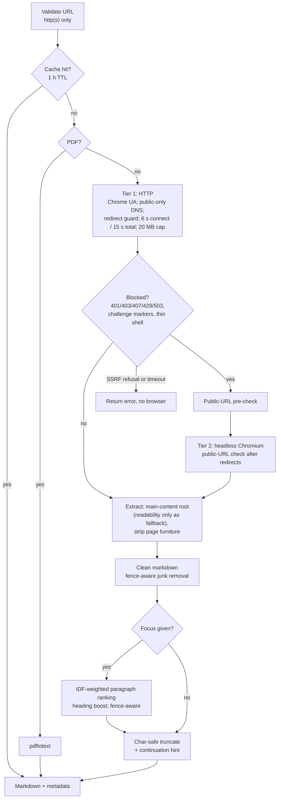
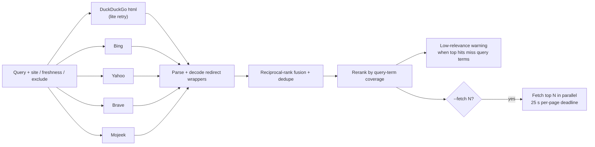

<div align="center">

# scour

**Local web access for LLM agents: one call searches, fetches, and returns clean, size-capped markdown.**

[](https://github.com/AdamUnderwood375/scour/actions/workflows/ci.yml) [](LICENSE) [](https://www.rust-lang.org)

</div>

scour is a single Rust binary. Run it as a CLI from your agent's bash tool, or as a stdio MCP server. No daemon, no API keys, no search-provider account.

## Why

Agents pay for every byte a tool returns, and they pay again on every later turn because the transcript is re-sent. Web research is mostly a turn-count and output-size problem, so scour is built around those:

- **One call does search and fetch.** `search --fetch 3` returns the top hits and the text of the top three pages together.
- **Size-capped, focused markdown.** `--max-chars` caps output on a paragraph boundary. `focus` keeps only paragraphs that match your query. Truncated output ends with the exact command to read the rest.
- **Facts from APIs, not HTML.** `gh` and `pkg` read GitHub, crates.io, npm, and PyPI directly.

## Measured

Benchmark: a three-wave research task run in one persistent agent session on `claude-haiku-5-5` (thinking off), with the scour cache cleared before each wave.

- **Wave 1:** latest versions and GitHub stars of Axum and Actix Web.
- **Wave 2:** find three recent comparison articles and their trade-offs.
- **Wave 3:** the Axum middleware API from the docs, with a code example.

Quality is scored automatically against live crates.io and GitHub APIs, URL liveness checks, and content checks.

| setup | model calls | total tokens | cost | wall | quality |
|---|---|---|---|---|---|
| scour as MCP tools (v0.1) | 17 | 3.85M | $0.651 | 77 s | 93/100 |
| scour CLI + skill (v0.1) | 19 | 591k | $0.0186 | 89 s | 92/100 |
| scour CLI + skill (v0.2, mean of 3 runs) | 13.3 | 284k | $0.0117 | 61 s | 100/100 |

- MCP tool results stay in the context and are re-sent on every later turn, so each extra call costs more than its own output.
- v0.2 removes round trips: `search --fetch` fetches pages in the same call, `gh`/`pkg` answer fact questions without scraping, and truncation hints are paste-able continuations.
- Numbers vary run to run and depend on search-engine availability. This is one task on one model, not a general benchmark.
- Reproduce it with `bench/` (see [bench/README.md](bench/README.md)).

Quality is scored against live crates.io/GitHub data at scoring time (v0.1 rows were scored when they ran), so re-scoring old runs after a new upstream release lowers their score. The v0.2 runs ranged from 11 to 16 calls.

## Install

Prebuilt binaries for Linux and macOS (x86_64 and aarch64) are on the [Releases page](https://github.com/AdamUnderwood375/scour/releases). Linux binaries need glibc >= 2.35 (Ubuntu 22.04+, Debian 12+). Or download from the command line:

```sh
gh release download --repo AdamUnderwood375/scour --pattern '*x86_64-unknown-linux-gnu.tar.gz'
tar xzf scour-*-x86_64-unknown-linux-gnu.tar.gz scour && install -m 755 scour ~/.local/bin/
```

With Rust installed, install from git. The crates.io name `scour` belongs to another project:

```sh
cargo install --git https://github.com/AdamUnderwood375/scour --tag v0.2.0
# unpinned (latest main): cargo install --git https://github.com/AdamUnderwood375/scour
```

To build from source:

```sh
git clone https://github.com/AdamUnderwood375/scour
cd scour
cargo build --release                # binary: target/release/scour
```

Building from source requires Rust 1.89+ (edition 2024). Optional runtime dependencies:

| Dependency | Needed for | Notes |
|---|---|---|
| Chromium-based browser | JavaScript and bot-walled pages; `screenshot` | Auto-detects `/usr/bin/brave`, `/usr/bin/brave-browser`, `/opt/brave-bin/brave`, `/usr/bin/chromium`, `/usr/bin/google-chrome-stable`, then on macOS `/Applications/Brave Browser.app`, `Google Chrome.app`, and `Chromium.app`. Finally Playwright's Chromium under `~/.cache/ms-playwright` (`~/Library/Caches/ms-playwright` on macOS). Override with `SCOUR_BROWSER=/path/to/browser`. |
| `pdftotext` (poppler) | PDF URLs and PDF responses | Without it, PDFs return a warning and no text. |
| `GITHUB_TOKEN` | Heavy use of `gh` | Optional. Unauthenticated GitHub API allows 60 requests/hour. |

Without a browser, plain-HTTP pages still work. Only blocked pages need one.

## Quick start

```sh
scour 'https://docs.rs/axum/latest/axum/middleware/index.html' --focus "from_fn"          # one page, focused
scour gh tokio-rs/axum actix/actix-web --readme --max-chars 800                          # stars, license, release, README excerpt
scour pkg crates axum actix-web                                                           # latest version + description
scour search "axum vs actix web 2025" --max 8 --fetch 3 --max-chars 2500                  # hits + top 3 pages as markdown
printf '%s\n' 'https://a.example/x' 'https://b.example/y' | scour batch --focus "rate limiting"   # parallel, input order
scour links https://docs.rs/axum/latest/axum/ --filter middleware --max 15                # sub-pages to read next
scour crawl https://docs.rs/axum/latest/axum/middleware/ --max-pages 4 --focus from_fn --max-chars 5000
scour scrape 'https://example.com/long-page' --focus "pricing" --max-chars 3000           # focus + size cap
scour screenshot 'https://example.com' -o /tmp/example.png                                # rendered PNG
```

## CLI reference

`scour <url> [focus...] [flags]` is shorthand for `scour scrape`. Run `scour --help` for the full text.

| Command | Key flags (default) | Notes |
|---|---|---|
| `scrape <url> [focus...]` | `--focus Q`, `--max-chars N` (6000), `--offset N`, `--json`, `--stats` | Positional words and `--focus` are merged. |
| `batch [urls...]` | `--focus Q`, `--max-chars N` (6000), `--parallel N` (4), `--json`, `--stats` | URLs from stdin when none given; `#` lines are comments. First 20 inputs are used. |
| `search <query...>` | `--max N` (10), `--site D`, `--freshness day\|week\|month\|year`, `--fetch N` (0, max 8), `--focus Q` (defaults to query), `--max-chars N` (2500), `--json`, `--stats` | `--max-chars` applies to fetched pages. |
| `gh <owner/repo\|url>...` | `--readme` (adds ~1500-char excerpt), `--focus Q`, `--max-chars N` | `--focus` and `--max-chars` require `--readme`. Shows stars, license, latest release. |
| `pkg <crates\|npm\|pypi> <name>...` | none | Latest version and description. |
| `links <url>` | `--filter S` (case-insensitive, URL or text), `--same-site`, `--max N` (100) | One `text — url` line per link. Includes nav and sidebar links. |
| `crawl <url>` | `--max-pages N` (10, max 50), `--depth N` (2), `--focus Q`, `--max-chars N` (2500 per page), `--sitemap`, `--json`, `--stats` | Same domain only; focus-aware best-first order. |
| `screenshot <url>` | `-o PATH` (default `/tmp/scour-<unix_ts>.png`) | PNG of the rendered page (viewport) via the browser tier. |
| `cache-clear` | none | Clears the 1-hour cache. |
| `--version`, `--help` | none | `--version` prints JSON. |
| *(no arguments)* | none | Starts the stdio MCP server. |

### Output

- **Stdout is markdown.** `scrape` prints `# <title>`, then `<!-- tier: http content_ok: true chars: 4812 -->`, then the content. `tier` is `http` or `chrome`.
- **Multi-page output** (`batch`, `crawl`, `search --fetch`) prints each page as `## <url>` plus its content. Failed pages print `## <url>` with `<!-- error: … -->`.
- **Search** prints `N. title — url` with a snippet line. A `<!-- warning: low relevance … -->` line means the engines returned mostly off-topic hits.
- **Stderr** carries `page_type`, `quality`, `links`, `next_offset`, and warnings.
- **Truncation** ends the output with a hint you can paste:
  ```
  <!-- truncated at 6000 of 18342 chars; more: scour scrape 'https://…' --offset 6000 --max-chars 6000 --focus '…' -->
  ```
- **`--json`** prints the result object. `batch` prints an array. `search --json` adds a `pages` key when `--fetch` is used. Failed items become `{url, content_ok: false, error}`.
- **`--stats`** prints one `stats: {json}` line per fetch on stderr. Scrape keys include `tier`, `status`, `cache` (`hit`/`miss`), `ms`, `bytes_down`, `chars_out`, `est_tokens`, `truncated`, `quality`, and `page_type`. `search` reports per-engine status, e.g. `["ddg:ok:10","bing:ok:9","brave:blocked:http429"]`.

### Exit codes

| Code | Meaning |
|---|---|
| `0` | Success |
| `1` | Runtime failure. `gh`/`pkg` exit 1 if any lookup failed. `batch` and `search --fetch` exit 1 only if every page failed. |
| `2` | Usage error (bad flag, unknown registry, `--max-chars 0`) |

## Use from an agent

### (a) Agent skill: cheapest path

The repo ships `skills/scour/SKILL.md`: a recipe table plus rules that keep runs to one bash call per recipe and one to three scour calls per task. Copy it into your agent's skills directory:

```sh
mkdir -p ~/.claude/skills/scour && cp skills/scour/SKILL.md ~/.claude/skills/scour/   # Claude Code
mkdir -p ~/.pi/agent/skills/scour && cp skills/scour/SKILL.md ~/.pi/agent/skills/scour/ # pi
```

The skill runs `scour` from `PATH` and falls back to `~/scour/target/release/scour`. No server or schema is loaded, so the agent pays no tool-schema cost.

### (b) MCP server

Register the binary with any MCP client that can spawn a stdio subprocess:

```json
{
  "mcpServers": {
    "scour": {
      "command": "/path/to/scour/target/release/scour",
      "env": { "SCOUR_BROWSER": "/usr/bin/brave" }
    }
  }
}
```

`env` is optional. Use plain `"command": "scour"` if it is on `PATH`.

| Tool | Purpose | Parameters |
|---|---|---|
| `scrape` | Markdown and metadata for one page | `url`, `focus?`, `max_chars?` (40000), `offset?`, `include_links?`, `include_media?`, `actions?` (click/fill/press/wait/scroll), `pages?` (PDF page range) |
| `scrape_batch` | Up to 10 URLs in parallel | `urls`, `focus?`, `max_chars?` (40000) |
| `crawl` | Same-domain best-first crawl: markdown per page plus link graph | `url`, `max_pages?` (5, max 20), `max_depth?` (2, max 4), `focus?`, `max_chars?` (8000), `sitemap?`, `discover_only?`, `max_total_chars?` |
| `search` | Keyless search, deduped and ranked | `query`, `max_results?` (10, max 20), `site?`, `freshness?`, `exclude_sites?` |
| `screenshot` | PNG of the rendered page (viewport) as base64 | `url` |
| `github_repo` | Same as `gh` | `repo`, `readme?`, `max_chars?`, `focus?` |
| `package_info` | Same as `pkg` | `registry`, `name` |
| `cache_clear` | Flush the cache | none |
| `scour_version` | Version and feature list | none |

MCP defaults differ from the CLI: `max_chars` is 40000 for `scrape` and `scrape_batch`, where the CLI uses 6000. Set it explicitly when you want the CLI's size.

MCP results are JSON and stay in the agent's context. For token-sensitive work, the CLI plus skill is the cheaper path (see [Measured](#measured)).

## How it works

### Fetch pipeline



Notes:
- The browser is launched once per process and reused.
- Timeouts and SSRF refusals never escalate to the browser: a host that does not answer HTTP will not answer Chrome either.

### Search pipeline



Notes:
- Each engine is paced about 1.1 s apart. The pacing state is shared across processes through `~/.cache/scour/engines.json`.
- An engine that is actually blocked enters a cooldown: 10 min for DuckDuckGo, 2 min for the others. If every engine is cooling down, cooldowns are bypassed rather than failing the search.
- The DuckDuckGo html endpoint falls back to lite once when it fails.

### Extraction and focus

- **Extraction:** the main content is the best-scoring of `article`, `main`/`[role=main]`, MediaWiki content, and common content containers with ≥200 chars of text; readability runs only if none qualify, `<body>` is last. Page furniture (by tag, ARIA role, and small class/id-tagged widgets such as nav, cookie and share bars) is stripped before conversion; `<pre>` blocks become fenced code verbatim; Wikipedia infoboxes follow the lead paragraph. Link-dominated pages (Hacker News, index pages) are classified `list`.
- **Focus:** the query is tokenised and paragraphs are scored with IDF-weighted term frequency. Headings get a boost. Fenced code blocks are never split. Results come back in page order. If nothing matches, the unfocused page is returned with a `<!-- focus matched nothing … -->` note.
- **Truncation** prefers a paragraph boundary and always cuts on a character boundary, so multi-byte text is never split.

### Cache

Usable pages (`content_ok`) are cached for 1 hour in an in-memory LRU (200 entries) backed by `~/.cache/scour/cache.json`, guarded by file locking so concurrent processes share it. Blocked and failed fetches are retried next time. `cache-clear` (CLI) and `cache_clear` (MCP) flush both layers.

## Security

scour is meant to be given URLs by an agent, so it refuses to reach internal networks.

- **Refused destinations:** loopback, private (RFC 1918), link-local (including cloud metadata at `169.254.169.254`), CGNAT `100.64.0.0/10`, unspecified, multicast, documentation ranges, `0.0.0.0/8`, IPv6 ULA `fc00::/7`, and IPv6 link-local `fe80::/10`.
- **Embedded IPv4 is judged by the IPv4 address.** This covers IPv4-mapped (`::ffff:a.b.c.d`), IPv4-compatible, NAT64 (`64:ff9b::/96` and `64:ff9b:1::/48`), and 6to4 (`2002::/16`) forms.
- **Non-http(s) schemes** are rejected.
- **Three enforcement points:** the HTTP client's DNS resolver drops non-public addresses before any socket opens, which also covers redirect hops. The redirect policy caps hops at 10 and rejects literal non-public IPs. The browser path checks the URL before navigation and again on the final URL after redirects.

**Known limitation: DNS rebinding.** The browser resolves DNS itself after scour's pre-check. A hostname that returns a public address to the check and a private one to Chrome can get past it. If you need a hard guarantee, run scour where it has no route to internal networks.

## Known limitations

- **Reddit** blocks unauthenticated access, HTML and JSON alike, from most IPs. Expect `content_ok: false`.
- **X/Twitter** returns only a login shell without an account.
- **DuckDuckGo and Mojeek** rate-limit or captcha datacenter and heavy-use IPs. scour cools them down and relies on the other engines, so results can be thinner.
- **DNS rebinding** can get past the browser-tier pre-check. See [Security](#security).

## Development

```sh
cargo fmt --check
cargo test                       # unit tests
cargo test -- --ignored          # live gh/pkg checks (needs network)
cargo clippy --all-targets -- -D warnings
cargo build --release
```

CI (`.github/workflows/ci.yml`) runs `cargo fmt --check` and `cargo clippy --all-targets -- -D warnings`, then `cargo test` and `cargo build --release` on `ubuntu-latest` and `macos-15`, plus `cargo check` on Rust 1.89 (MSRV). Live network tests are `#[ignore]`d so CI stays deterministic. Pushing a `v*` tag runs `.github/workflows/release.yml`, which builds the release binaries and creates the GitHub Release.

Source layout:

| File | Contents |
|---|---|
| `src/main.rs` | Entry point: dispatches to the CLI or the MCP server |
| `src/cli.rs` | CLI parsing and output |
| `src/mcp.rs` | MCP server (rmcp) and tools |
| `src/scrape.rs` | Scrape pipeline: focus, truncation, PDF, crawl, links, screenshot |
| `src/fetcher.rs` | HTTP tier, block detection, SSRF guards, headless Chromium tier |
| `src/extractor.rs` | Main-content selection, boilerplate stripping, code blocks, markdown cleanup |
| `src/search.rs` | Engine queries, pacing and cooldowns, parsers, rank fusion |
| `src/tools.rs` | `gh` and `pkg` lookups (GitHub, crates.io, npm, PyPI) |
| `src/cache.rs` | 1-hour LRU and file cache |
| `src/types.rs` | Shared request and result types |

Agent skill: `skills/scour/SKILL.md`.

## License

MIT. See [LICENSE](LICENSE).
